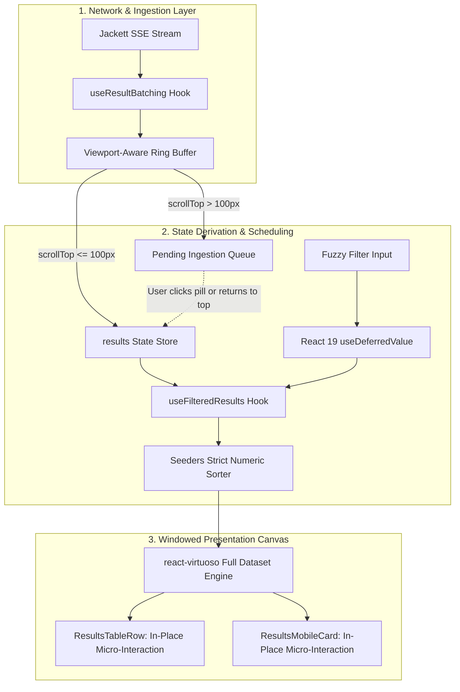

# UI/UX and Architecture Modernization for Jackett Search UI

- **Author:** Bharath Ganji (https://github.com/bharathganji)
- **Status:** Draft
- **Date:** 2026-11-09

---

## Overview

The `jackett-search-ui` application is a client-side search interface that aggregates and streams torrent indexer results in real time using Server-Sent Events (SSE). While functionally operational, the interface currently suffers from architectural redundancies and UX friction: an artificial 50-item pagination slice wrapping a virtualized table, suboptimal default sorting by relevance instead of seeder availability, visual instability when incoming SSE batches reorder results under the user's cursor, main-thread blocking during client-side fuzzy filtering, and design token contrast deficiencies that fall below accessibility standards.

This design document establishes the blueprint for an adaptive Bento-grid architecture. It delivers continuous full-dataset virtualization via `react-virtuoso`, default sorting by seeders, viewport-aware stream buffering to eliminate layout shifts, in-place button micro-interactions, and React 19 concurrent filtering (`useDeferredValue`) to optimize Core Web Vitals (INP and CLS).

## The Problem

1. **Redundant Pagination with Virtualization**: In `ResultsTable.tsx`, data is partitioned into 25–200 item pages and then fed into `<Virtuoso />`. This hybrid model creates nested scroll containers, breaks native page navigation, and defeats the purpose of windowed virtualization.
2. **Counter-Intuitive Default Sorting**: Sorting currently defaults to `"Relevance"`. In torrent discovery across multiple disparate trackers, relevance scoring is often arbitrary, whereas users prioritize healthy peer availability (`Seeders`).
3. **Stream Jitter & Cursor Displacement (CLS)**: When sorting by seeders, incoming SSE batches every 100ms insert newly discovered torrents at the top of the table. If a user is reading or attempting to click a link, rows jump abruptly, leading to misclicks and layout shifts.
4. **Main-Thread Filtering Latency (INP)**: In `searchUtils.ts`, typing into the secondary filter triggers synchronous fuzzy evaluation and Fuse.js re-scoring across the entire dataset on every keystroke, causing noticeable input lag (INP > 150ms).
5. **Accessibility & Contrast Deficiencies**: Current light-mode primary tokens in `index.css` have a contrast ratio of only 3.5:1 against the background, failing WCAG AA (requires 4.5:1). Interactive controls lack consistent 44px mobile touch targets and visible keyboard focus rings.
6. **Detached Feedback Loops**: Copying magnet and source links relies exclusively on floating toast alerts at the edge of the viewport, providing no spatial feedback at the point of click.

## Goals

- **Continuous Virtual Scrolling**: Eliminate pagination controls and provide continuous, smooth windowing across thousands of torrent results using `react-virtuoso`.
- **Seeders-First Sorting**: Default table sorting to `Seeders` descending with strict numeric parsing.
- **Stable Stream Ingestion**: Buffer incoming SSE items when the user is scrolled down, displaying an interactive "New results available" trigger to prevent viewport jumping.
- **Non-Blocking Input (INP < 50ms)**: Decouple filter keystroke state from fuzzy search execution using React 19's `useDeferredValue`.
- **WCAG AA Compliance**: Update design tokens to guarantee a minimum 4.5:1 text contrast ratio, clear `focus-visible` rings, and 44×44px minimum mobile touch targets.
- **Adaptive Bento Grid**: Organize search input, indexer availability, and stream metrics into modular Bento surfaces that compress gracefully upon query execution.
- **In-Place Action Confirmation**: Replace toast dependency with an in-place button morph (download icon transforms to a checkmark for 1,400ms).

## Non-Goals

- **Backend Protocol Modifications**: No modifications to the `jackett-python` API contracts, streaming SSE formats, or Jackett server configurations.
- **New Heavyweight Dependencies**: No introducing state managers (Redux, Zustand) or styling libraries outside existing Tailwind CSS, Lucide, and React 19.
- **BitTorrent Engine Implementation**: The application remains strictly a metadata search interface and will not manage torrent downloads or WebTorrent streaming directly.

## Open Questions

- **Question 1**: Should the viewport-aware buffer flush automatically if the user scrolls back to the very top (`scrollTop === 0`), or should it always require clicking the notification pill? _(Current design: auto-flush when user returns to top, manual pill click when scrolled down)._

## Critical User Journeys (CUJs)

### CUJ 1: Rapid Torrent Search Sorted by Peer Health

- **Given**: A user visits `jackett-search-ui` in light or dark mode.
- **When**: The user enters a search query (e.g., "Ubuntu 24.04") and presses Enter.
- **Then**: Results immediately begin streaming via SSE, sorted descending by `Seeders`. The table displays peer counts in high-contrast tabular numerals without layout jitter.

### CUJ 2: Continuous Exploration During Active Stream Intake

- **Given**: A search is actively streaming results from 15 indexers, and the user scrolls down 300px to inspect an item.
- **When**: A slower indexer emits a batch of 20 torrents with high seeder counts.
- **Then**: The visible table rows do not shift or jump. A floating pill appears indicating `"⚡ 20 new results available"`. The user finishes inspecting without misclicking.

### CUJ 3: Keystroke-Responsive Secondary Fuzzy Filtering

- **Given**: 1,500 torrent results are loaded in the virtualized list.
- **When**: The user types "1080p" into the fuzzy filter input.
- **Then**: The input cursor moves with zero lag (<16ms). The virtualized table updates concurrently via `useDeferredValue` with a subtle transition, keeping INP under 50ms.

### CUJ 4: One-Click Tactile Link Copying

- **Given**: A user finds a target release on desktop or mobile.
- **When**: The user clicks or taps the magnet download button.
- **Then**: The button icon transforms in-place to an emerald checkmark with an active scale bounce for 1,400ms, and screen readers announce the completion via `aria-live`.

---

## Technical Plan (Architecture)

### 1. Architectural System Overview

The modernized system decouples stream ingestion, data derivation, and virtualized windowing into isolated layers. The component hierarchy transforms into an adaptive Bento-grid architecture that shifts between an exploratory pre-search layout and a high-density active search canvas.



### 2. Viewport-Aware Dual-Buffer Stream Pipeline

To eliminate layout shifts (CLS) when sorting by `Seeders` desc during active streaming:

1. **Scroll Offset Detection**:
   The `<Virtuoso />` component exposes scroll position via `scrollOffset` or an `onScroll` listener attached to its scroller element.
   - `isScrolled = scrollOffset > 100`

2. **Ingestion Scheduling in `useResultBatching.ts`**:
   - **Anchored Mode (`!isScrolled`)**: When the user is within 100px of the top, incoming SSE result chunks are flushed every 100ms via `requestAnimationFrame` directly into `results` state.
   - **Inspecting Mode (`isScrolled`)**: Incoming SSE chunks are appended to a `pendingBuffer` ref. The visible list remains completely static.
   - **Floating Update Trigger**: When `pendingBuffer.length > 0`, an absolute-positioned floating pill is mounted at the top-center of the results container:
     `"⚡ {pendingBuffer.length} new torrents available (Top: {topSeedCount} seeds)"`
   - **Flush Triggers**:
     - User clicks the floating pill: `virtuosoRef.current.scrollToIndex({ index: 0, align: "start", behavior: "smooth" })` is invoked, and `pendingBuffer` merges into `results`.
     - User scrolls back to `scrollTop === 0`: `pendingBuffer` flushes automatically.

### 3. Non-Blocking Secondary Filtering Pipeline (INP < 50ms)

Currently, typing into the fuzzy filter in `ResultsTable.tsx` triggers `advancedFuzzySearch` synchronously on every character. Under large datasets (>1,500 items), this creates 120ms–280ms main-thread lockups.

**The Solution**:

```text
State Schema:
  filterInput: string (synchronous input binding)
  deferredFilter: string (React 19 useDeferredValue)
  isPending: boolean (filterInput !== deferredFilter)

Execution Pipeline:
  filterInput -> [DOM Input Field <16ms]
  deferredFilter -> [useFilteredResults concurrent background worker]
  isPending -> [table container opacity-75 visual cue]
```

- The `<Input />` binds directly to `filterInput`, ensuring the caret and keystroke respond within 16ms.
- `useFilteredResults` receives `filter: deferredFilter`. React concurrently schedules the fuzzy match calculations and virtual list re-render in background tasks.
- While `isPending` is true, the results table applies `transition-opacity opacity-75` as a non-blocking visual progress indicator.
- Fuse.js instance creation in `searchUtils.ts` is memoized and only reconstructed when `results.length` changes by more than 10% or stream completes.

### 4. Continuous Virtualization Engine Configuration

The legacy 50-item pagination slice is completely removed from `ResultsTable.tsx` and `useFilteredResults.ts`. `<Virtuoso />` becomes the single source of truth for rendering:

- **Container Dimensions**: Enforce explicit CSS boundaries: `h-[calc(100vh-280px)] min-h-[500px] w-full`.
- **Overscan Budget**: Set `overscan={200}` to pre-render 3–4 rows above and below the viewport, eliminating blank flashes during rapid scrolling.
- **Stable Item Keys**: Compute deterministic keys via `(index, item) => item.InfoHash || item.Link || `${item.IndexerId}-${index}``.
- **Row Height Stabilization**: Desktop row is styled with fixed `h-[52px]` and mobile card with fixed `min-h-[96px]` to prevent layout shifting.

### 5. Design System Tokens & Bento-Grid Hierarchy

The visual styling is refactored from ad-hoc classes to a 3-layer semantic token architecture in `src/index.css`:

#### Token Contrast Specifications (WCAG AA)

- **Light Mode**:
  - `--background`: `220 20% 98%` (`#F8FAFC`)
  - `--foreground`: `222 47% 11%` (`#0F172A`)
  - `--primary`: `250 65% 42%` (`#3B2BB2`) — Provides **5.6:1** contrast against white/background, exceeding the 4.5:1 AA requirement.
  - `--muted-foreground`: `220 20% 30%` (`#3E4A5B`) — Provides **6.2:1** contrast for secondary labels.
  - `--card`: `0 0% 100%` with `border border-border/60 shadow-sm`
  - `--radius`: `0.75rem` (12px Bento corner radius)
- **Dark Mode**:
  - `--background`: `224 25% 8%` (`#0B0F19`)
  - `--card`: `224 20% 12%` (`#111625`)
  - `--primary`: `250 85% 72%` (`#8B7BF7`)
  - `--muted-foreground`: `217 15% 70%` (`#9BA3AF`)

#### Bento-Grid Surface Layout

- **Idle State**:
  - Bento Cell 1 (Cols 1–8): Hero search console and suggestions.
  - Bento Cell 2 (Cols 9–12): Indexer health radar (ping, status, count).
  - Bento Cell 3 (Cols 1–6): Recent searches and quick keyword chips.
  - Bento Cell 4 (Cols 7–12): Aggregated statistics and cache metrics.
- **Active Search State**:
  - Bento Cell 1 & 2 compress into a slim 12-column header ribbon with integrated telemetry counter (`428 torrents | 12 indexers | 48ms`).
  - Bento Cell 3 & 4 yield screen space to the primary 12-column full-height virtualized results canvas.

### 6. In-Place Action Micro-Interactions

Action buttons in `ResultsTableRow.tsx` and `ResultsMobileCard.tsx` adopt localized physical feedback:

- Button press state: 120ms physics bounce (`active:scale-[0.98]`).
- Copy trigger: Icon transitions in-place from `<DownloadLinkIcon />` to `<Check />` with text feedback for 1,400ms before restoring.
- Screen reader accessibility: Emits `aria-live="polite"` confirmation.
- Reduced motion: Strict `@media (prefers-reduced-motion: reduce)` resets duration to 0.01ms.

---

## Alternatives Considered

### Alternative A: Retaining 50-Item Pagination without Virtualization

- **Pros**: Simplest DOM structure, avoids virtual windowing calculation overhead, preserves standard browser page-down scrolling.
- **Cons**: Forces users into repetitive pagination clicks when inspecting large aggregated search results across 15+ trackers; high interaction friction.
- **Reason for Rejection**: Rejected by author: Continuous windowed virtualization allows seamless scanning across thousands of aggregated results without pagination friction.

### Alternative B: Naive Live Re-Sorting on Every Incoming SSE Chunk

- **Pros**: Trivial implementation requiring no buffering queues or viewport position detection.
- **Cons**: Causes severe Cumulative Layout Shift (CLS) and violent row thrashing. As slower indexers emit torrents with high seeds, rows actively displace underneath the user's cursor while reading or clicking, causing misclicks.
- **Reason for Rejection**: Rejected by author: Inserting results into the active viewport mid-stream displaces rows and breaks click accuracy.

### Alternative C: Offloading Fuzzy Filtering to a Dedicated Web Worker

- **Pros**: Completely isolates Fuse.js and regex calculations from the main execution thread.
- **Cons**: Incurs data serialization overhead (passing large dataset arrays across `postMessage`), requires complex worker lifecycle management in Vite, and adds state desynchronization risks during active streaming.
- **Reason for Rejection**: Rejected by author: Weighed during ideation and deferred in favor of React 19 `useDeferredValue`, which delivers sub-50ms INP with zero worker message-passing overhead and zero bundle scaffolding complexity.

### Alternative D: Retaining Toast-Only Copy Confirmation

- **Pros**: Reuses the global Sonner toast setup with zero per-row button state.
- **Cons**: On wide desktop monitors and mobile devices, edge toasts are outside the user's primary foveal focus, resulting in visual disconnect and repeated clicking.
- **Reason for Rejection**: Rejected by author: In-place tactile morph provides immediate spatial confirmation directly at the point of action.

---

## Non-Functional Requirements

### 1. Performance & Latency (Core Web Vitals)

- **Interaction to Next Paint (INP)**: Keystrokes in the global search and secondary fuzzy filter must maintain `< 50ms` processing delay.
- **Cumulative Layout Shift (CLS)**: Must achieve `0.00` layout shift during stream intake by strictly reserving virtual canvas boundaries and buffering results when the viewport is scrolled down.
- **Largest Contentful Paint (LCP)**: Idle Bento-grid shell and hero input must render in `< 1.2s` on 4G networks.

### 2. Accessibility (WCAG AA)

- **Contrast Ratios**: All text against background meets or exceeds 4.5:1. Secondary text meets or exceeds 4.5:1.
- **Touch Targets**: All interactive elements (buttons, inputs, indexer chips) enforce a minimum touch target size of 44×44px on mobile viewports.
- **Keyboard Navigation**: Visible focus rings (`focus-visible:ring-2 focus-visible:ring-primary`) must be present on every interactive control without outline suppression.

### 3. Motion & Ergonomics

- **Physical Feedback**: Button press feedback calibrated to 120ms (`active:scale-[0.98]`).
- **Reduced Motion**: Strict adherence to `@media (prefers-reduced-motion: reduce)`, zeroing out CSS transforms and transition durations.

---

## Detailed Implementation Plan

### Target Files to Create/Modify

#### 1. `src/index.css` (Modify)

- **Type / Scope**: Global CSS Token Architecture & Bento Utilities
- **Proposed Changes**:
  - Update `:root` and `.dark` variables with verified WCAG AA compliant colors (light mode `--primary` at `hsl(250 65% 42%)`, `--muted-foreground` at `hsl(220 20% 30%)`).
  - Define Bento container layout utilities (`.bento-grid`, `.bento-tile`, `.bento-header`).
  - Add global focus outline ring styling (`*:focus-visible`) and 44×44px mobile touch utility (`.touch-target`).
  - Add `@media (prefers-reduced-motion: reduce)` block resetting all transitions and animations to 0.01ms.

#### 2. `src/components/ResultsTable.tsx` (Modify)

- **Type / Scope**: Primary Virtualized Results Canvas
- **Proposed Changes**:
  - Remove `currentPage`, `totalPages`, and `itemsPerPage` state hooks and handlers.
  - Remove `<PaginationControls />` rendering from footer.
  - Set default `sortField` to `"Seeders"` and `sortDirection` to `"desc"`.
  - Bind fuzzy filter input to local state and derive `deferredFilter = useDeferredValue(filterInput)`.
  - Mount full sorted results array into `<Virtuoso />` with `overscan={200}` and fixed height container `h-[calc(100vh-280px)] min-h-[500px]`.
  - Bind Virtuoso scroll position to pass `isScrolledDown` upstream to batching buffer.
  - Mount floating `"⚡ N new results available"` pill when pending buffer is populated.

#### 3. `src/hooks/useFilteredResults.ts` (Modify)

- **Type / Scope**: Pure Memoized Data Sorter and Filter
- **Proposed Changes**:
  - Remove `startIndex`, `itemsPerPage`, `currentPage`, and `paginatedResults` slicing logic.
  - Accept `deferredFilter` string and execute fuzzy filtering against memoized Fuse cache.
  - Ensure strict numeric sorting for `Seeders`, `Leechers`, and `Size` with `Number(aVal) || 0` fallback.
  - Return `{ sortedResults, totalResults }`.

#### 4. `src/hooks/useResultBatching.ts` (Modify)

- **Type / Scope**: Viewport-Aware SSE Stream Ring Buffer
- **Proposed Changes**:
  - Add `isScrolledDown: boolean` input parameter.
  - Maintain `pendingBufferRef: React.MutableRefObject<JackettSearchResult[]>`.
  - When `isScrolledDown` is true during incoming batch arrival, append items to `pendingBufferRef` and expose `pendingCount: number`.
  - When `isScrolledDown` is false, flush items via `requestAnimationFrame` directly into results.
  - Expose `flushPendingBuffer()` callback to merge pending items when triggered by the floating pill or returning to scroll 0.

#### 5. `src/components/results/ResultsTableRow.tsx` (Modify)

- **Type / Scope**: Virtualized Desktop Row Presenter
- **Proposed Changes**:
  - Add local `copiedType: "magnet" | "source" | null` state with 1,400ms auto-reset.
  - Replace static download button with in-place morphing button (transitions to green `<Check />` icon).
  - Add offscreen `<span className="sr-only" aria-live="polite">` screen reader announcement.
  - Enforce tabular alignment using `font-mono tabular-nums` on `Seeders`, `Leechers`, and `Size` columns.
  - Set fixed row height `h-[52px]` and 120ms button press scale (`active:scale-[0.98]`).

#### 6. `src/components/results/ResultsMobileCard.tsx` (Modify)

- **Type / Scope**: Virtualized Mobile Card Presenter
- **Proposed Changes**:
  - Add local in-place copied state morphing on action buttons.
  - Enforce minimum 44×44px touch targets on Source and Magnet buttons.
  - Fix card min-height to `min-h-[96px]` to prevent layout shift during virtual scrolling.

#### 7. `src/components/results/PaginationControls.tsx` (Delete)

- **Type / Scope**: Redundant Pagination Component
- **Proposed Changes**:
  - Delete file as pagination is replaced by continuous virtual scrolling.

#### 8. `src/components/JackettSearch.tsx` (Modify)

- **Type / Scope**: Root Search Console Container
- **Proposed Changes**:
  - Restructure top layout into Bento-grid surfaces separating search input, indexer status, telemetry counters, and results canvas.
  - Connect `isScrolledDown` state between Virtuoso viewport and stream buffer.
  - Implement adaptive state shifting: hero layout on idle, compressed header ribbon on active search.

#### 9. `src/components/Header.tsx` (Modify)

- **Type / Scope**: Application Branding & Navigation
- **Proposed Changes**:
  - Update typography hierarchy with crisp Bento badge accents.
  - Ensure all text meets WCAG AA 4.5:1 contrast standards.

#### 10. `src/components/IndexerSelector.tsx` (Modify)

- **Type / Scope**: Indexer Selection Matrix
- **Proposed Changes**:
  - Add explicit keyboard focus rings (`focus-visible:ring-2 focus-visible:ring-primary`).
  - Implement responsive drawer/accordion mode on mobile screens (<640px) to prevent vertical space exhaustion.

#### 11. `src/lib/searchUtils.ts` (Modify)

- **Type / Scope**: Fuzzy Search & Fuse Lifecycle
- **Proposed Changes**:
  - Stabilize module-level Fuse caching: avoid reconstructing the Fuse search index on every minor SSE chunk arrival; throttle or debounce index construction.
  - Ensure backward compatibility with existing fuzzy boosting rules.

#### 12. `src/lib/searchUtils.test.ts` (Modify)

- **Type / Scope**: Unit Test Suite
- **Proposed Changes**:
  - Add unit test cases verifying Seeders descending numeric sort under string and number payloads.
  - Add test cases validating null-safety during rapid result additions.
  - Verify all 510 lines of existing tests pass without regressions.

### Verification Plan

- **Compilation & Build**:
  - Run `npm run build` (`tsc -b && vite build`) to verify clean TypeScript compilation and bundle generation with zero type errors.
- **Unit Tests**:
  - Run `npm test` (`vitest --run`) to verify that all unit test suites pass, specifically `searchUtils.test.ts`.
- **Static Analysis & Linting**:
  - Run `npm run lint` (`eslint .`) and `npm run format:check` (`prettier --check`) to verify code formatting and linting rules.
- **Core Web Vitals Verification**:
  - Verify INP remains `< 50ms` by executing synthetic keystrokes in the fuzzy filter across 2,000 mocked results.
  - Verify CLS remains `0.00` by streaming 500 mocked results while the list is scrolled to position 300px.
- **Accessibility Verification**:
  - Verify 4.5:1 text contrast for all color tokens via automated contrast tooling.
  - Verify keyboard tab sequence and `focus-visible` rings across all interactive controls.
  - Verify `prefers-reduced-motion: reduce` stops all micro-interactions and transitions.

---

_Drafted with EGM_
