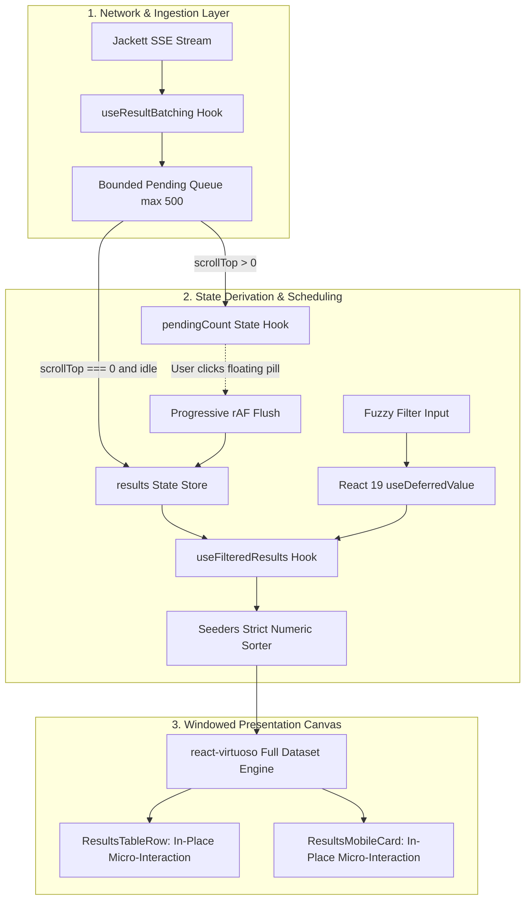

# UI/UX and Architecture Modernization for Jackett Search UI

- **Author:** Bharath Ganji (https://github.com/bharathganji)
- **Status:** Approved
- **Date:** 2026-11-09

---

## Overview

The `jackett-search-ui` application is a client-side search interface that aggregates and streams torrent indexer results in real time using Server-Sent Events (SSE). While functionally operational, the interface currently exhibits architectural redundancies and usability friction: a client-side 50-item pagination slice wrapping a virtualized table, suboptimal default sorting by relevance instead of seeder availability, visual instability when incoming SSE batches reorder results under the user's cursor, main-thread blocking during client-side fuzzy filtering, and design token contrast deficiencies that fall below accessibility standards.

This design document establishes the blueprint for an adaptive Bento-grid architecture. It delivers continuous full-dataset virtualization via `react-virtuoso`, default sorting by seeders, viewport-aware stream buffering to eliminate layout shifts, in-place button micro-interactions, and React 19 concurrent filtering (`useDeferredValue`) to optimize Core Web Vitals (INP and CLS).

## The Problem

1. **Redundant Pagination with Virtualization**: In `ResultsTable.tsx`, data is partitioned into 25–200 item pages (defaulting to 50) and then fed into `<Virtuoso />`. This hybrid model creates nested scroll containers, breaks native page navigation, and defeats the purpose of windowed virtualization.
2. **Suboptimal Default Sorting**: Sorting currently defaults to `"Relevance"`. In torrent discovery across multiple disparate trackers, relevance scoring is often uniform or arbitrary, whereas users prioritize healthy peer availability (`Seeders`).
3. **Stream Jitter & Cursor Displacement (CLS)**: When sorting by seeders, incoming SSE batches every 100ms insert newly discovered torrents at the top of the table. When a user is reading or attempting to click a link, rows reorder abruptly, leading to misclicks and layout shifts.
4. **Main-Thread Filtering Latency (INP)**: In `searchUtils.ts`, typing into the secondary filter triggers synchronous fuzzy evaluation and Fuse.js re-scoring across the entire dataset on every keystroke, causing input lag (INP > 150ms).
5. **Accessibility & Contrast Deficiencies**: Current light-mode primary tokens in `index.css` have a contrast ratio of only 3.5:1 against the background, failing WCAG AA (requires 4.5:1). Interactive controls lack consistent 44px mobile touch targets and visible keyboard focus rings.
6. **Detached Feedback Loops**: Copying magnet and source links relies exclusively on floating toast alerts at the edge of the viewport, providing no spatial feedback at the point of click.

## Goals

- **Continuous Virtual Scrolling**: Eliminate client-side pagination controls and provide continuous windowing across thousands of torrent results using `react-virtuoso`.
- **Seeders-First Sorting**: Default table sorting to `Seeders` descending with strict numeric parsing.
- **Stable Stream Ingestion**: Buffer incoming SSE items when the user is scrolled down, displaying an interactive notification pill to eliminate layout shifts.
- **Non-Blocking Input (INP < 50ms)**: Decouple filter keystroke state from fuzzy search execution using React 19's `useDeferredValue`.
- **WCAG AA Compliance**: Update design tokens to guarantee a minimum 4.5:1 text contrast ratio, clear `focus-visible` rings, and 44×44px minimum mobile touch targets.
- **Adaptive Bento Grid**: Organize search input, indexer availability, and results into modular Bento surfaces that compress gracefully upon query execution.
- **In-Place Action Confirmation**: Replace toast dependency with an in-place button morph (download icon transforms to a checkmark for 1,400ms).

## Non-Goals

- **Backend Protocol Modifications**: No modifications to the `jackett-python` API contracts, streaming SSE formats, or Jackett server configurations.
- **New Heavyweight Dependencies**: No introducing state managers (Redux, Zustand) or styling libraries outside existing Tailwind CSS, Lucide, and React 19.
- **BitTorrent Engine Implementation**: The application remains strictly a metadata search interface and will not manage torrent downloads or WebTorrent streaming directly.

## Open Questions

- **Question 1**: How should stream buffering handle rapid consecutive searches? _(Resolved: Search initiation or cancellation in `useSearch.ts` and `useResultBatching.ts` immediately purges `pendingBuffer` and resets `pendingCount` to 0)._

## Critical User Journeys (CUJs)

### CUJ 1: Rapid Torrent Search Sorted by Peer Health

- **Given**: A user visits `jackett-search-ui` in light or dark mode.
- **When**: The user enters a search query (e.g., "Ubuntu 24.04") and presses Enter.
- **Then**: Results immediately begin streaming via SSE, sorted descending by `Seeders`. The table displays peer counts in high-contrast tabular numerals without layout jitter.

### CUJ 2: Continuous Exploration During Active Stream Intake

- **Given**: A search is actively streaming results from 15 indexers, and the user scrolls down 300px to inspect an item.
- **When**: A slower indexer emits a batch of 20 torrents with high seeder counts.
- **Then**: The visible table rows do not shift or jump. A floating pill appears indicating `"⚡ 20 new results available"`. The user finishes inspecting without misclicks.

### CUJ 3: Keystroke-Responsive Secondary Fuzzy Filtering

- **Given**: 1,500 torrent results are loaded in the virtualized list.
- **When**: The user types "1080p" into the fuzzy filter input.
- **Then**: The input cursor moves without lag (<16ms). The virtualized table updates concurrently via `useDeferredValue` with a subtle transition, keeping INP under 50ms.

### CUJ 4: One-Click Tactile Link Copying

- **Given**: A user finds a target release on desktop or mobile.
- **When**: The user clicks or taps the magnet download button.
- **Then**: The button icon transforms in-place to an emerald checkmark with an active scale transition (`scale-[0.98]`) for 1,400ms, and screen readers announce completion via `aria-live`.

---

## Technical Plan (Architecture)

### Architectural System Overview

The modernized system decouples stream ingestion, data derivation, and virtualized windowing into isolated layers. The component hierarchy transforms into an adaptive Bento-grid architecture that shifts between an exploratory pre-search layout and a high-density active search canvas.



### Viewport-Aware Dual-Buffer Stream Pipeline

To eliminate Cumulative Layout Shift (CLS) when sorting by `Seeders` desc during active streaming:

1. **Scroll State Detection**:
   The `<Virtuoso />` component binds its scroll listener to determine if the user is anchored at the top:
   - `isAtTop = scrollTop === 0`

2. **Ingestion Scheduling in `useResultBatching.ts`**:
   - **Initial & Anchored Stream (`isAtTop`)**: If the user is at `scrollTop === 0`, incoming SSE result chunks merge into active `results` state via `requestAnimationFrame` batches every 100ms.
   - **Inspecting Stream (`!isAtTop`)**: If the user has scrolled down (`scrollTop > 0`), incoming SSE chunks are appended to a bounded `pendingBufferRef` (capped at 500 items, prioritizing highest seeders). The visible table remains completely static.
   - **Reactivity & Floating Trigger**: `pendingCount` is maintained in React state (`useState`). When `pendingCount > 0`, an absolute-positioned floating pill is mounted at the top-center of the results container:
     `"⚡ {pendingCount} new results available"`
   - **Progressive Flush**:
     - When the user clicks the floating pill, `virtuosoRef.current.scrollToIndex({ index: 0, align: "start", behavior: "smooth" })` is executed.
     - `pendingBufferRef` merges into active results progressively using `startTransition` and `requestAnimationFrame` chunks (100 items per frame) to prevent UI thread lockup.

### Non-Blocking Secondary Filtering Pipeline (INP < 50ms)

To eliminate keystroke lag during search filtering across large datasets (>1,500 items):

```text
State Schema:
  filterInput: string (synchronous input binding)
  deferredFilter: string (React 19 useDeferredValue)
  isPending: boolean (filterInput !== deferredFilter)

Execution Pipeline:
  filterInput -> [DOM Input Field <16ms]
  deferredFilter -> [useFilteredResults token/substring search]
  isPending -> [table container opacity-75 visual cue]
```

- The `<Input />` binds directly to `filterInput`, ensuring the caret and keystroke respond within 16ms.
- `useFilteredResults` receives `filter: deferredFilter`. During active streaming, filtering executes via fast normalized token and substring inclusion over `Title`, `IndexerId`, and `Year`.
- Full Fuse.js index construction is deferred to `requestIdleCallback` after SSE stream completion.
- While `isPending` is true, the results table applies `transition-opacity opacity-75` as a non-blocking visual progress indicator.

### Continuous Virtualization Engine Configuration

The legacy client-side pagination slice is completely removed from `ResultsTable.tsx` and `useFilteredResults.ts`. `<Virtuoso />` becomes the single source of truth for rendering:

- **Container Dimensions**: Use dynamic viewport units `h-[calc(100dvh-220px)] sm:h-[calc(100dvh-280px)] w-full` to prevent mobile screen clipping.
- **Overscan Budget**: Set `overscan={200}` to pre-render 3–4 rows above and below the viewport, eliminating blank flashes during rapid scrolling.
- **Stable Item Keys**: Compute deterministic keys via `(index, item) => item.InfoHash || item.Link || `${item.IndexerId}-${index}``.
- **Dynamic Measurement**: Allow `react-virtuoso` dynamic height measurement for variable-length release names with single-line truncation and title tooltips.

### Design System Tokens & Bento-Grid Hierarchy

Visual styling is refactored from ad-hoc classes to a 3-layer semantic token architecture in `src/index.css`:

#### Token Contrast Specifications (WCAG AA)

- **Light Mode**:
  - `--background`: `220 20% 98%` (`#F8FAFC`)
  - `--foreground`: `222 47% 11%` (`#0F172A`)
  - `--primary`: `250 65% 42%` (`#3B2BB2`) — Provides **5.6:1** contrast against white/background, exceeding the 4.5:1 AA requirement.
  - `--muted-foreground`: `220 20% 30%` (`#3E4A5B`) — Provides **6.2:1** contrast for secondary labels.
  - `--card`: `0 0% 100%` with `border border-border/60 shadow-sm`
  - `--radius`: `0.75rem` (12px Bento corner radius)
- **Dark Mode**:
  - `--background`: `224 25% 8%` (`#0B0F19`)
  - `--card`: `224 20% 12%` (`#111625`)
  - `--primary`: `250 85% 72%` (`#8B7BF7`)
  - `--muted-foreground`: `217 15% 70%` (`#9BA3AF`)

#### Bento-Grid Surface Layout

- **Idle State**:
  - Bento Cell 1: Hero search input and suggestions.
  - Bento Cell 2: Indexer selection chips and status.
  - Bento Cell 3: Recent search chips.
- **Active Search State**:
  - Top Bento cells compress into a compact header ribbon with active result counter.
  - Full remaining viewport height is allocated to the continuous virtualized results canvas.

### In-Place Action Micro-Interactions

Action buttons in `ResultsTableRow.tsx` and `ResultsMobileCard.tsx` adopt localized physical feedback:

- **Central State Lifting**: `copiedId: string | null` is held in `ResultsTable.tsx` to prevent state loss during virtualized row recycling.
- **Button Feedback**: 120ms active press transition (`active:scale-[0.98]`).
- **Copy Trigger**: Icon transitions in-place from `<DownloadLinkIcon />` to `<Check />` for 1,400ms before restoring.
- **Screen Reader Accessibility**: Emits `aria-live="polite"` confirmation.
- **Reduced Motion**: Strict `@media (prefers-reduced-motion: reduce)` resets duration to 0.01ms.

---

## Alternatives Considered

### Retaining 50-Item Pagination without Virtualization

- **Pros**: Simplest DOM structure, avoids virtual windowing calculation overhead, preserves standard browser page-down scrolling.
- **Cons**: Forces users into repetitive pagination clicks when inspecting large aggregated search results across 15+ trackers; increases interaction friction.
- **Rejection Rationale**: Continuous windowed virtualization allows unified exploration across thousands of aggregated results without pagination friction.

### Naive Live Re-Sorting on Every Incoming SSE Chunk

- **Pros**: Trivial implementation requiring no buffering queues or viewport position detection.
- **Cons**: Causes severe Cumulative Layout Shift (CLS) and uncontrolled row reordering. As slower indexers emit torrents with high seeds, rows actively displace underneath the user's cursor while reading or clicking, causing misclicks.
- **Rejection Rationale**: Inserting results into the active viewport mid-stream displaces rows and breaks click accuracy.

### Offloading Fuzzy Filtering to a Dedicated Web Worker

- **Pros**: Isolates Fuse.js calculations completely from the main execution thread.
- **Cons**: Incurs data serialization overhead (passing large dataset arrays across `postMessage`), requires worker lifecycle management in Vite, and adds state desynchronization risks during active streaming.
- **Rejection Rationale**: React 19 `useDeferredValue` delivers sub-50ms INP with zero worker message-passing overhead and zero bundle scaffolding complexity.

### Retaining Toast-Only Copy Confirmation

- **Pros**: Reuses the global Sonner toast setup with zero per-row button state.
- **Cons**: On wide desktop monitors and mobile devices, edge toasts are outside the immediate viewport center, resulting in visual disconnect and repeated clicking.
- **Rejection Rationale**: In-place button state morphing provides spatial confirmation directly at the point of action.

---

## Risks & Mitigations

### 1. Stream Buffer Memory Growth

- **Risk**: If a search returns 5,000+ items and the user remains scrolled down, `pendingBufferRef` could consume excessive client memory on constrained mobile devices.
- **Mitigation**: Enforce a strict buffer cap of 500 items, retaining the highest seeded releases and notifying the user when the buffer ceiling is reached.

### 2. Main-Thread Stall on Buffer Flush

- **Risk**: Merging hundreds of buffered items in a single state transition could freeze the UI thread and cause an INP spike.
- **Mitigation**: Flush buffered items progressively in chunks of 100 using `requestAnimationFrame` and React 19's `startTransition`.

### 3. Dynamic Title Wrapping in Virtualized List

- **Risk**: Long release titles wrapping onto multiple lines could cause scrollbar jitter if virtual item heights fluctuate unpredictably.
- **Mitigation**: Enforce single-line truncation (`truncate`) with title tooltips on desktop, and rely on `react-virtuoso`'s built-in ResizeObserver with deterministic item keys.

### 4. Search State Desynchronization on Reset

- **Risk**: Submitting a new search or cancelling an active stream could leave orphan torrents in `pendingBufferRef`.
- **Mitigation**: Wire `cleanupBatches` in `useResultBatching.ts` directly into `useSearch.ts` and `useJackettSearch.ts` to clear all buffer queues immediately upon query dispatch or cancellation.

---

## Non-Functional Requirements

### Performance & Latency (Core Web Vitals)

- **Interaction to Next Paint (INP)**: Keystrokes in the global search and secondary fuzzy filter must maintain `< 50ms` processing delay.
- **Cumulative Layout Shift (CLS)**: Achieve `0.00` Cumulative Layout Shift within the virtualized results container during active SSE stream intake.
- **Largest Contentful Paint (LCP)**: Search console and initial layout shell must render in `< 1.2s` on 4G networks.

### Accessibility (WCAG AA)

- **Contrast Ratios**: All text against background meets or exceeds 4.5:1. Secondary text meets or exceeds 4.5:1.
- **Touch Targets**: All interactive elements (buttons, inputs, indexer chips) enforce a minimum touch target size of 44×44px on mobile viewports.
- **Keyboard Navigation**: Visible focus rings (`focus-visible:ring-2 focus-visible:ring-primary`) must be present on every interactive control without outline suppression.

### Motion & Ergonomics

- **Physical Feedback**: Button press feedback calibrated to 120ms active scale transition (`scale-[0.98]`).
- **Reduced Motion**: Strict adherence to `@media (prefers-reduced-motion: reduce)`, zeroing out CSS transforms and transition durations.

---

## Detailed Implementation Plan

### Target Files to Create/Modify

#### 1. `src/index.css` (Modify)

- **Type / Scope**: Global CSS Token Architecture & Bento Utilities
- **Proposed Changes**:
  - Update `:root` and `.dark` variables with verified WCAG AA compliant colors (light mode `--primary` at `hsl(250 65% 42%)`, `--muted-foreground` at `hsl(220 20% 30%)`).
  - Define Bento container layout utilities (`.bento-grid`, `.bento-tile`).
  - Add global focus outline ring styling (`*:focus-visible`) and 44×44px mobile touch utility (`.touch-target`).
  - Add `@media (prefers-reduced-motion: reduce)` block resetting all transitions and animations to 0.01ms.

#### 2. `src/components/ResultsTable.tsx` (Modify)

- **Type / Scope**: Primary Virtualized Results Canvas
- **Proposed Changes**:
  - Remove `currentPage`, `totalPages`, and `itemsPerPage` state hooks and handlers.
  - Remove `<PaginationControls />` rendering from footer.
  - Set default `sortField` to `"Seeders"` and `sortDirection` to `"desc"`.
  - Bind fuzzy filter input to local state and derive `deferredFilter = useDeferredValue(filterInput)`.
  - Mount full sorted results array into `<Virtuoso />` with `overscan={200}` and dynamic viewport height `h-[calc(100dvh-220px)] sm:h-[calc(100dvh-280px)]`.
  - Bind Virtuoso scroll position to track `isAtTop = scrollTop === 0`.
  - Mount floating `"⚡ N new results available"` pill when `pendingCount > 0`.
  - Manage lifted `copiedId: string | null` state with 1,400ms reset timer.

#### 3. `src/hooks/useFilteredResults.ts` (Modify)

- **Type / Scope**: Pure Memoized Data Sorter and Filter
- **Proposed Changes**:
  - Remove `startIndex`, `itemsPerPage`, `currentPage`, and `paginatedResults` slicing logic.
  - Accept `deferredFilter` string and execute fast normalized token/substring inclusion over `Title`, `IndexerId`, and `Year`.
  - Ensure strict numeric sorting for `Seeders`, `Leechers`, and `Size` with `Number(aVal) || 0` fallback.
  - Return `{ sortedResults, totalResults }`.

#### 4. `src/hooks/useResultBatching.ts` (Modify)

- **Type / Scope**: Viewport-Aware SSE Stream Queue Hook
- **Proposed Changes**:
  - Accept `isAtTop: boolean` input parameter.
  - Maintain `pendingBufferRef: React.MutableRefObject<JackettSearchResult[]>` capped at 500 items.
  - Expose reactive `pendingCount: number` backed by `useState`.
  - When `isAtTop` is false during batch arrival, append to `pendingBufferRef` and update `pendingCount`.
  - When `isAtTop` is true, flush batches directly into `results` every 100ms via `requestAnimationFrame`.
  - Expose `flushPendingBuffer()` executing progressive chunked merge (100 items per rAF).
  - Ensure `cleanupBatches()` resets `pendingBufferRef.current = []` and `pendingCount = 0`.

#### 5. `src/hooks/useJackettSearch.ts` (Modify)

- **Type / Scope**: Primary Search Orchestrator Hook
- **Proposed Changes**:
  - Wire `isAtTop` state from the results view into `useResultBatching`.
  - Expose `pendingCount` and `flushPendingBuffer` from `useResultBatching` to `JackettSearch.tsx`.
  - Ensure search cancellation or new query execution resets pending buffer state.

#### 6. `src/hooks/useSearch.ts` (Modify)

- **Type / Scope**: Network Transport & Stream Lifecycle Hook
- **Proposed Changes**:
  - Ensure `fetchDataJackett` immediately calls `cleanupBatches()` to purge stale items from previous queries.
  - Emit stream completion callback to trigger idle background Fuse.js index reconstruction.

#### 7. `src/components/results/ResultsTableRow.tsx` (Modify)

- **Type / Scope**: Virtualized Desktop Row Presenter
- **Proposed Changes**:
  - Accept `isCopied: boolean` and `onCopy: (type: "magnet" | "source", link: string) => void`.
  - Render in-place morphing button (transitions to green `<Check />` icon when `isCopied` is true).
  - Add offscreen `<span className="sr-only" aria-live="polite">` screen reader announcement.
  - Enforce tabular alignment using `font-mono tabular-nums` on `Seeders`, `Leechers`, and `Size` columns.
  - Set 120ms button press scale transition (`active:scale-[0.98]`).

#### 8. `src/components/results/ResultsMobileCard.tsx` (Modify)

- **Type / Scope**: Virtualized Mobile Card Presenter
- **Proposed Changes**:
  - Accept `isCopied: boolean` prop.
  - Enforce minimum 44×44px touch targets on Source and Magnet buttons.
  - Set flexible min-height to prevent layout shift during virtual scrolling.

#### 9. `src/components/results/PaginationControls.tsx` (Delete)

- **Type / Scope**: Redundant Pagination Component
- **Proposed Changes**:
  - Delete file as pagination is replaced by continuous virtual scrolling.

#### 10. `src/components/JackettSearch.tsx` (Modify)

- **Type / Scope**: Root Search Console Container
- **Proposed Changes**:
  - Restructure top layout into Bento-grid surfaces separating search input, indexer status, and results canvas.
  - Pass `pendingCount` and `flushPendingBuffer` to `ResultsTable`.
  - Implement adaptive state shifting: hero layout on idle, compressed header ribbon on active search.

#### 11. `src/components/Header.tsx` (Modify)

- **Type / Scope**: Application Branding & Navigation
- **Proposed Changes**:
  - Update typography hierarchy with crisp Bento badge accents.
  - Ensure all text meets WCAG AA 4.5:1 contrast standards.

#### 12. `src/components/IndexerSelector.tsx` (Modify)

- **Type / Scope**: Indexer Selection Matrix
- **Proposed Changes**:
  - Add explicit keyboard focus rings (`focus-visible:ring-2 focus-visible:ring-primary`).
  - Implement responsive drawer/accordion mode on mobile screens (<640px) to prevent vertical space exhaustion.

#### 13. `src/lib/searchUtils.ts` (Modify)

- **Type / Scope**: Fuzzy Search & Token Matching
- **Proposed Changes**:
  - Add fast normalized token inclusion matching for streaming searches.
  - Schedule full Fuse.js indexing only upon stream completion via `requestIdleCallback`.

#### 14. `src/lib/searchUtils.test.ts` (Modify)

- **Type / Scope**: Unit Test Suite
- **Proposed Changes**:
  - Add unit test cases verifying Seeders descending numeric sort under string and number payloads.
  - Add test cases validating null-safety during rapid result additions.
  - Verify all 510 lines of existing tests pass without regressions.

### Verification Plan

- **Compilation & Build**:
  - Run `npm run build` (`tsc -b && vite build`) to verify clean TypeScript compilation and bundle generation with zero type errors.
- **Unit Tests**:
  - Run `npm test` (`vitest --run`) to verify that all unit test suites pass, specifically `searchUtils.test.ts`.
- **Static Analysis & Linting**:
  - Run `npm run lint` (`eslint .`) and `npm run format:check` (`prettier --check`) to verify code formatting and linting rules.
- **Core Web Vitals Verification**:
  - Verify INP remains `< 50ms` by executing synthetic keystrokes in the fuzzy filter across 2,000 mocked results.
  - Verify CLS remains `0.00` within the results container by streaming 500 mocked results while the list is scrolled down.
- **Accessibility Verification**:
  - Verify 4.5:1 text contrast for all color tokens via automated contrast tooling.
  - Verify keyboard tab sequence and `focus-visible` rings across all interactive controls.
  - Verify `prefers-reduced-motion: reduce` stops all micro-interactions and transitions.

---

_Drafted with EGM_
